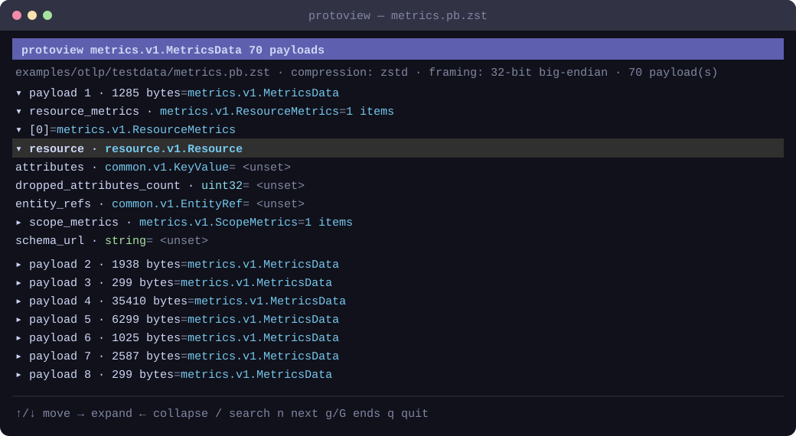

# protoview — Protobuf Viewer

`protoview` is an interactive terminal viewer for protobuf payloads. It loads a
proto3 schema at runtime, detects the message type, and presents decoded fields in a
searchable tree.



## Installation

With the Go version declared in [`go.mod`](go.mod), install the latest version on
any supported platform:

```sh
go install github.com/signalfx/protoview@latest
```

The executable is installed in `GOBIN` when it is set, or in
`$(go env GOPATH)/bin` otherwise. Make sure that directory is included in your
`PATH`. To install a specific release, replace `latest` with its version tag,
such as `v0.0.1`.

Prebuilt binaries are also attached to GitHub releases.

To build from a source checkout instead:

```sh
make build
```

The binary is written to `bin/protoview`. It has no runtime dependency on `protoc`,
compression command-line tools, or shared libraries. To install it on your path:

```sh
mkdir -p "$HOME/.local/bin"
install -m 0755 bin/protoview "$HOME/.local/bin/protoview"
```

## Usage

```text
protoview [-message package.Message] PAYLOAD SCHEMA
```

- `PAYLOAD` is a protobuf payload file. It may be uncompressed, gzip-compressed, or
  Zstandard-compressed.
- `SCHEMA` is a `.proto` file or a directory containing `.proto` files. Directory
  inputs are searched recursively. Schemas must use proto3 syntax.
- `-message package.Message` selects a fully qualified root message type. Without
  this option, `protoview` tests the schema's message types and selects the best
  match.

After decompression, `protoview` recognizes streams whose entire contents consist of
32-bit big-endian or little-endian length-prefixed messages. Otherwise, it treats the
file as one protobuf payload. Decompressed input is limited to 64 MiB and framed
streams are limited to 10,000 payloads.

### OTLP example

The repository includes Zstandard-compressed OpenTelemetry payloads. Initialize the
schema submodule after a non-recursive clone, then open the metrics fixture:

```sh
git submodule update --init --recursive
make build
./bin/protoview \
  examples/otlp/testdata/metrics.pb.zst \
  examples/otlp/opentelemetry-proto
```

## Controls

| Key | Action |
| --- | --- |
| `↑`/`↓`, `j`/`k` | Move between rows |
| `→`, `l`, `Enter`, `Space` | Expand the selected value |
| `←`, `h` | Collapse the selected value or its parent |
| `g`/`G`, `Home`/`End` | Jump to the first or last row |
| `Page Up`/`Page Down` | Move by one viewport |
| `/` | Start a case-insensitive full-text search |
| `n` | Find the next match |
| `Esc` | Cancel search input or an active search |
| `q`, `Ctrl+C` | Quit |

Search covers message names, field names, field types, map keys, and field values in
every decoded payload. Selecting a match reveals its containing messages
automatically.
